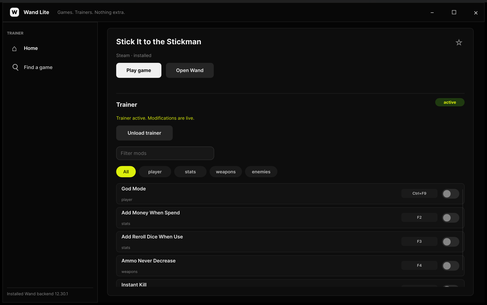
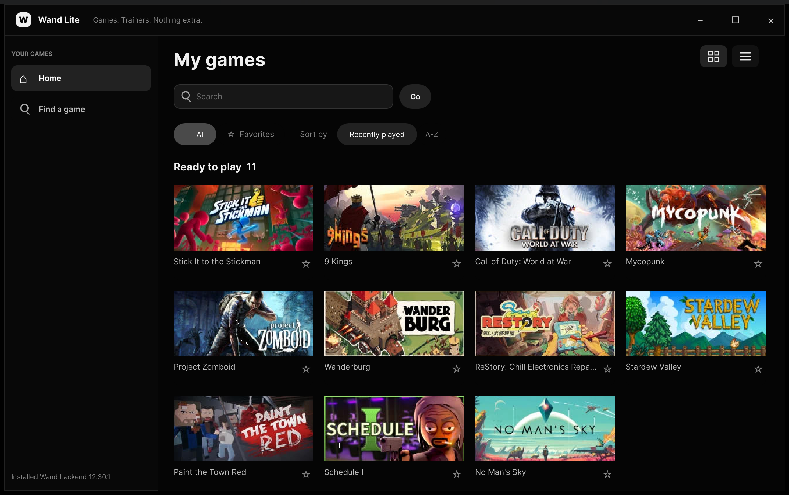
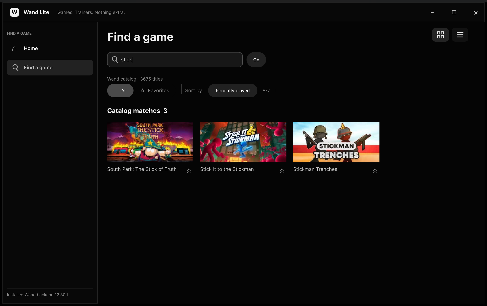

# Wand Lite Rust

A native Windows game-library and trainer client for the trainer runtime that
the **Wand** desktop app installs. Rust + [Slint](https://slint.dev), no Electron,
no embedded browser.

It drives the installed Wand trainer runtime directly — you close Wand and use
this instead, at roughly **1/40th of the memory**.



> Unofficial project. Not affiliated with Wand, WeMod, or any game publisher.
> No Wand binaries, trainer DLLs, game artwork or catalog data are included in
> this repository. Read [NOTICE.md](NOTICE.md) before using it.

## What it does

| | |
|---|---|
|  |  |
| Steam library with artwork, search, favorites, sorting | Wand catalog browsing with on-demand artwork |

- **Library** — discovers installed Steam games (and one Microsoft Store title),
  matches them against Wand's public catalog, downloads box art, remembers
  favorites and sort order.
- **Trainers** — resolves the right trainer for a game, loads it through the
  installed Wand runtime, and renders its real modifications as native controls
  (toggles, sliders, numbers, hotkey chips).
- **Hotkeys** — rebindable per modification, registered globally so they work
  while the game has focus.
- **Session feedback** — every change is confirmed by the trainer's own
  `ValueResponse` and log line, surfaced as `on` / `off` / `pending` / `failed`.

## How it works

Wand Lite is a **client**, not a trainer reimplementation. It contains no cheats
and no memory offsets. The installed Wand application supplies the runtime and
the trainer binaries; Wand Lite drives them over Wand's own IPC.

```
Slint UI
  └─ trainer panel ── game resolution (Steam manifests → running process)
                   ── trainer resolution (blueprint cache → trainer + variables)
                   ── named-pipe transport (WeMod\Trainer_*)
                   ── Win32 injection (TrainerLib!Run + bootstrap struct)
                          └─ runs inside the game process
```

A session, in order:

1. Resolve the game's install directory from Steam manifests, then find the
   running process under it.
2. Pick the cached trainer whose `supportedVersions` matches the installed game
   build.
3. Create `\\.\pipe\WeMod\Trainer_<ms>_{In,Out,Log}` — **the client is the pipe
   server**.
4. `LoadLibraryW(TrainerLib_x64.dll)` into the game and start its `Run` export
   with a 1552-byte bootstrap struct (pipe paths, trainer path, PID, game
   version, variable names).
5. Wait for `Ready`, then send `Value` frames; the trainer answers
   `ValueResponse(result=0)` and logs `<target> set to <n> by client.`
6. Unload by closing the pipes.

Protocol details, byte offsets and evidence: [BACKEND_MAP.md](BACKEND_MAP.md)
and [docs/LEGACY_PROTOCOL.md](docs/LEGACY_PROTOCOL.md).

## Requirements

- Windows 10/11 x64
- The official **Wand** desktop app installed and signed in **once**, so the
  trainer runtime and the trainers you want are on disk
- [Rust MSVC toolchain](https://rust-lang.org/tools/install/) + Microsoft C++
  build tools / Windows SDK (to build)

## Build

```powershell
cd rust
cargo test --workspace --release
cargo build --package wand-rebuild-ui --release
```

`build.ps1` wraps both and sets a shared target directory. The artifact is
`rust\target\release\wand-rebuild-ui.exe` (or the `CARGO_TARGET_DIR` set by the
script).

## Usage

1. **One-time:** open each game's trainer page in Wand once so it caches the
   trainer and its blueprint. Then close Wand — it is not needed again for that
   game.
2. Start the game.
3. Start `wand-rebuild-ui.exe`, select the game, press **Load trainer**.
4. Toggle modifications, rebind keys by clicking a modification's key chip.
5. **Unload trainer** when done, or just exit.

Diagnostics:

```powershell
.\wand-rebuild-ui.exe --self-check              # environment / catalog / runtime report
.\wand-rebuild-ui.exe --trainer-self-test       # full live session (game must be running)
cargo run --release --example hotkey_probe      # global hotkey hook
cargo run --release --example legacy_session -- --probe
```

Session logs are written to `%LOCALAPPDATA%\WandRebuild\trainer.log`.

## Verified status

Confirmed against Wand 12.30.1 and *Stick It to the Stickman*:

- trainer resolved (`50696`, `trainerlib` backend), runtime injected, `Ready`
  received
- all five modifications enabled/disabled, each acknowledged by the trainer
- clean unload; hotkey rebinding captured and persisted
- works with **zero Wand processes running**

`cargo test --workspace --release` → **74 tests**, including a real Windows
named-pipe round trip.

## Memory

Five runs, medians, same machine, Wand Lite Core as the reference:

| Process group | Processes | Private | Working set |
|---|---:|---:|---:|
| Wand Lite Core (idle library) | 7 | 872.1 MiB | 1784.7 MiB |
| Wand Lite Rust (idle library) | 1 | 23.4 MiB | 44.2 MiB |
| **Reduction** | | **97.3%** | **97.5%** |

Startup to a responsive window: median 1.73 s. The trainer runtime that patches
memory runs inside the game process and is excluded from both groups — see
[docs/BENCHMARK_FINDINGS.md](docs/BENCHMARK_FINDINGS.md) for methodology and
limits.

## Limitations

- **One trainer session per game launch.** The runtime installs hooks that
  survive module unload, so restart the game before loading a trainer again; the
  app detects this and says so immediately.
- **Tophat backend** is implemented at the protocol level (FlatBuffers codecs,
  bounded gRPC transport, port registry) but has not been exercised live — every
  trainer cached on the development machine used `trainerlib`.
- **In-game effect** is confirmed by the trainer's acknowledgements and logs, not
  by observing gameplay.
- Trainer downloads, account sign-in and authenticated metadata are not
  implemented; the client uses what Wand has already cached.
- Hotkeys, overlay, maps, clips, guides and voice are out of scope so far.

## Repository layout

```
rust/core/       protocol, discovery, resolution, injection, session, hotkeys
rust/ui/         Slint UI, app state, trainer panel, presentation logic
docs/            protocol evidence, backend findings, benchmark, screenshots
src/, tests/     earlier C# protocol reference (kept for compatibility checks)
```

## Licence

MIT — see [LICENSE](LICENSE). Bundled Inter fonts are under the SIL Open Font
License (`rust/ui/assets/fonts/LICENSE.txt`). See [NOTICE.md](NOTICE.md) for
third-party and trademark notices.
