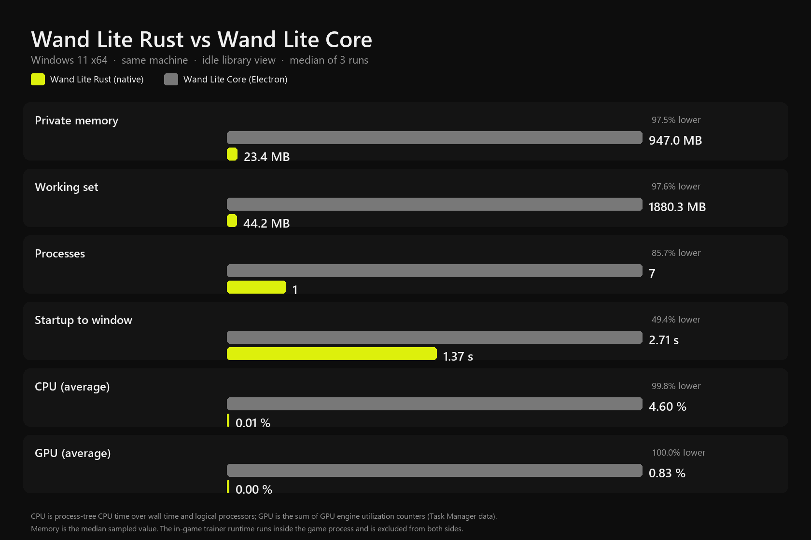
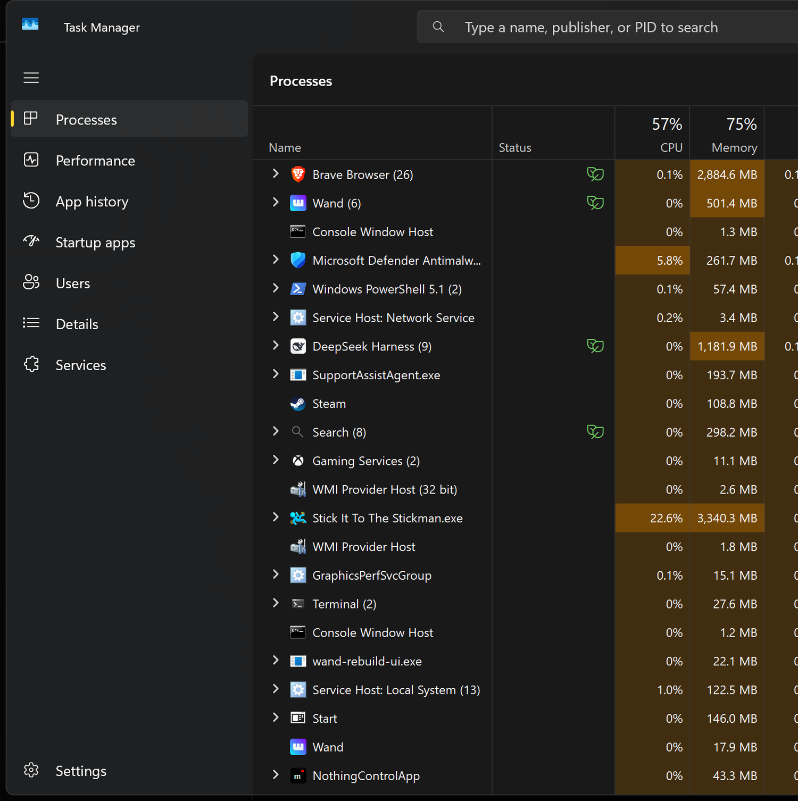

# Performance: Wand Lite Rust vs Wand Lite Core (Electron)

Measured on the same machine, same session, with both applications sitting on
their idle library view. Three runs each; the median of the three is reported.

## Results

| Metric | Wand Lite Core (Electron) | Wand Lite Rust | Difference |
|---|---:|---:|---:|
| Processes | 7 | **1** | 85.7% fewer |
| Private memory | 947.0 MB | **23.4 MB** | **97.5% lower** |
| Working set | 1880.4 MB | **44.2 MB** | **97.6% lower** |
| Startup to visible window | 2.71 s | **1.37 s** | 49.4% faster |
| CPU, average | 4.60% | **0.01%** | 99.8% lower |
| GPU, average | 0.83% | **0.00%** | 100% lower |

The Task Manager screenshot above shows both applications running at once:
`Wand (6)` at 501.4 MB and `wand-rebuild-ui.exe` at 22.1 MB. Task Manager's
Memory column is the private working set, which is smaller than the summed
working set in the table; both figures are reported above for clarity.

## Method

`work/tools/bench_compare.ps1`:

1. Kills any previous instance, starts the executable and times how long until a
   process in the target group owns a visible main window.
2. Waits a warm-up period (12 s in the final runs) so start-up work settles.
3. Samples once per second for 10 s:
   - **CPU** — process-tree CPU time delta divided by wall time and the logical
     processor count (100% = every core busy).
   - **GPU** — sum of `\GPU Engine(*)\Utilization Percentage` counters for the
     processes, the same data Task Manager displays.
   - **Private memory / working set** — summed over every process in the group.
   - **Process count** — number of processes in the group.
4. Repeats three times per application; the median of the three runs is used.

Raw samples: `docs/bench/runs/wand-electron-{1,2,3}.json` and
`docs/bench/runs/wand-lite-{1,2,3}.json`. The chart is rendered from those files
by `work/tools/render_bench.py`, so the numbers in this document can be
re-derived from the raw data.

## Honest notes and limits

- **The trainer runtime is excluded from both sides.** When a trainer is loaded
  it runs inside the *game* process, so its memory is not part of either
  application's footprint. This comparison is the client application only.
- **CPU/GPU percentages are relative to the whole machine**, not to one core.
  Electron's idle cost comes from its renderer/GPU processes; a native window
  that only redraws on input measures at effectively zero.
- **Electron memory varies with state.** Wand's numbers grow when the store,
  search, or a trainer page is open. The figures here are the idle library view,
  the most favourable case for Electron.
- **Startup** measures until a window exists, not until it is fully painted. The
  native client is consistently faster, but both are in the low seconds.
- **Summed working set double-counts shared pages** (for example the shared
  Electron/Chromium DLLs). Private memory is the fairer per-application figure;
  both are listed.
- Single machine, single GPU (hybrid Intel + NVIDIA laptop), 32 logical
  processors. Absolute numbers will differ elsewhere; the ratios are the point.
